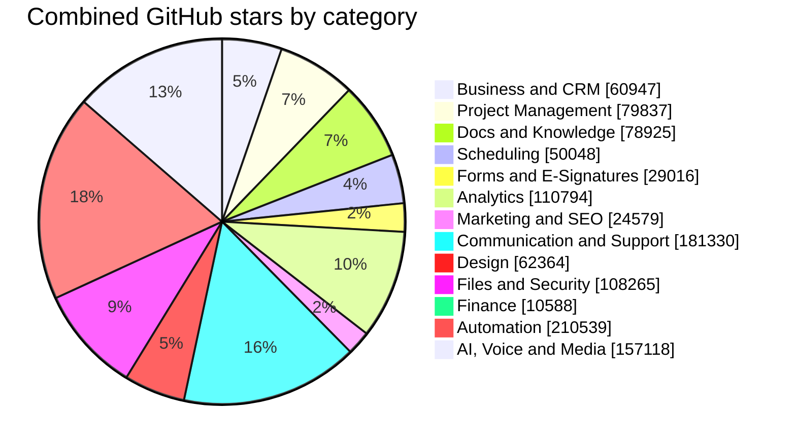

# Awesome Craft 

> A curated list of open-source, self-hostable alternatives to popular SaaS tools.

Paid SaaS bills add up fast. Every project here can be self-hosted, and each entry names the paid tool it replaces. Check each project's licence before you host or resell it for clients.

## Contents

- [Dashboard](#dashboard)
- [Business and CRM](#business-and-crm)
- [Project Management](#project-management)
- [Docs and Knowledge](#docs-and-knowledge)
- [Scheduling](#scheduling)
- [Forms and E-Signatures](#forms-and-e-signatures)
- [Analytics](#analytics)
- [Marketing and SEO](#marketing-and-seo)
- [Communication and Support](#communication-and-support)
- [Design](#design)
- [Files and Security](#files-and-security)
- [Finance](#finance)
- [Automation](#automation)
- [AI, Voice and Media](#ai-voice-and-media)

## Dashboard

<table>
<tr>
<td align="center"><h2>25</h2>open-source tools</td>
<td align="center"><h2>28</h2>SaaS products replaced</td>
<td align="center"><h2>1.16M</h2>combined GitHub stars</td>
<td align="center"><h2>206.8k</h2>combined forks</td>
<td align="center"><h2>24/25</h2>pushed in the last 30 days</td>
<td align="center"><h2>10</h2>languages</td>
</tr>
</table>

Stats snapshot taken on 2026-11-15 from the GitHub API. Star badges next to each entry update live.

### 🏆 Leaderboard

<table>
<tr><th>Rank</th><th>Project</th><th>Replaces</th><th align="right">Stars</th><th></th></tr>
<tr><td align="center">🥇</td><td><b>n8n</b></td><td>Zapier</td><td align="right">210.5k</td><td><code>████████████████████</code></td></tr>
<tr><td align="center">🥈</td><td><b>VoiceStudio</b></td><td>ElevenLabs</td><td align="right">110.8k</td><td><code>███████████</code></td></tr>
<tr><td align="center">🥉</td><td><b>AppFlowy</b></td><td>Notion</td><td align="right">78.9k</td><td><code>███████</code></td></tr>
<tr><td align="center">4</td><td><b>Vaultwarden</b></td><td>1Password</td><td align="right">70.7k</td><td><code>███████</code></td></tr>
<tr><td align="center">5</td><td><b>Plane</b></td><td>Jira, Linear</td><td align="right">62.5k</td><td><code>██████</code></td></tr>
<tr><td align="center">6</td><td><b>Penpot</b></td><td>Figma</td><td align="right">62.4k</td><td><code>██████</code></td></tr>
<tr><td align="center">7</td><td><b>Twenty</b></td><td>Salesforce, HubSpot</td><td align="right">60.9k</td><td><code>██████</code></td></tr>
<tr><td align="center">8</td><td><b>Cal.diy</b></td><td>Calendly</td><td align="right">50.0k</td><td><code>█████</code></td></tr>
<tr><td align="center">9</td><td><b>Rocket.Chat</b></td><td>Slack</td><td align="right">46.5k</td><td><code>████</code></td></tr>
<tr><td align="center">10</td><td><b>PostHog</b></td><td>Mixpanel, Amplitude</td><td align="right">40.8k</td><td><code>████</code></td></tr>
</table>

### Stars by category

### Licences

      

"Custom" means GitHub couldn't match the licence to a standard one, often because of open-core or extra terms. Read it before you use the project commercially.

## Business and CRM

- [Twenty](https://github.com/twentyhq/twenty) - Modern CRM with pipelines, records and workflows, an alternative to Salesforce and HubSpot. 

## Project Management

- [OpenProject](https://github.com/opf/openproject) - Full project management suite with Gantt, boards and time tracking, an alternative to Asana. 
- [Plane](https://github.com/makeplane/plane) - Issues, cycles and roadmaps, lighter than OpenProject, an alternative to Jira and Linear. 

## Docs and Knowledge

- [AppFlowy](https://github.com/AppFlowy-IO/AppFlowy) - Docs, wikis and databases in one workspace, an alternative to Notion. 

## Scheduling

- [Cal.diy](https://github.com/calcom/cal.diy) - Booking pages from the Cal.com team, an alternative to Calendly. 

## Forms and E-Signatures

- [Documenso](https://github.com/documenso/documenso) - Document signing with audit trails, an alternative to DocuSign. 
- [Formbricks](https://github.com/formbricks/formbricks) - Surveys and forms, an alternative to Typeform and SurveyMonkey. 

## Analytics

- [Plausible](https://github.com/plausible/analytics) - Lightweight, privacy-friendly web analytics, an alternative to Google Analytics. 
- [PostHog](https://github.com/PostHog/posthog) - Product analytics, session replay and feature flags, an alternative to Mixpanel and Amplitude. 
- [Umami](https://github.com/umami-software/umami) - Simple, privacy-focused web analytics, an alternative to Google Analytics. 

## Marketing and SEO

- [Listmonk](https://github.com/knadh/listmonk) - Newsletter and mailing list manager, an alternative to Mailchimp. 
- [OpenSEO](https://github.com/TahaHachana/OpenSEO) - Small SEO toolkit, last updated in 2016, so treat it as a placeholder, an alternative to Semrush. 

## Communication and Support

- [Cap](https://github.com/CapSoftware/Cap) - Screen recording and sharing, an alternative to Loom. 
- [Chatwoot](https://github.com/chatwoot/chatwoot) - Live chat and shared support inbox, an alternative to Intercom. 
- [Jitsi Meet](https://github.com/jitsi/jitsi-meet) - Video conferencing, an alternative to Zoom. 
- [Mattermost](https://github.com/mattermost/mattermost) - Team chat and collaboration, an alternative to Slack. 
- [Rocket.Chat](https://github.com/RocketChat/Rocket.Chat) - Team chat and omnichannel messaging, an alternative to Slack. 

## Design

- [Penpot](https://github.com/penpot/penpot) - Design and prototyping, an alternative to Figma. 

## Files and Security

- [Nextcloud](https://github.com/nextcloud/server) - File sync, sharing and collaboration, an alternative to Google Drive and Dropbox. 
- [Vaultwarden](https://github.com/dani-garcia/vaultwarden) - Lightweight Bitwarden-compatible password server, an alternative to 1Password. 

## Finance

- [Invoice Ninja](https://github.com/invoiceninja/invoiceninja) - Invoicing, quotes and payments, an alternative to FreshBooks. 

## Automation

- [n8n](https://github.com/n8n-io/n8n) - Workflow automation. Fair-code licence, not OSI open source, an alternative to Zapier. 

## AI, Voice and Media

- [Open Generative AI](https://github.com/Anil-matcha/Open-Generative-AI) - AI image and video generation. Self-described as uncensored, so not for client-facing work, an alternative to Higgsfield. 
- [OpenWhispr](https://github.com/OpenWhispr/openwhispr) - Voice-to-text dictation, an alternative to Wispr Flow. 
- [VoiceStudio](https://github.com/debpalash/VoiceStudio) - Local voice cloning and dubbing, an alternative to ElevenLabs. 

## Contributing

Contributions welcome! Read the [contribution guidelines](contributing.md) first.

If this list saved you a subscription, give it a ⭐ so others can find it.

